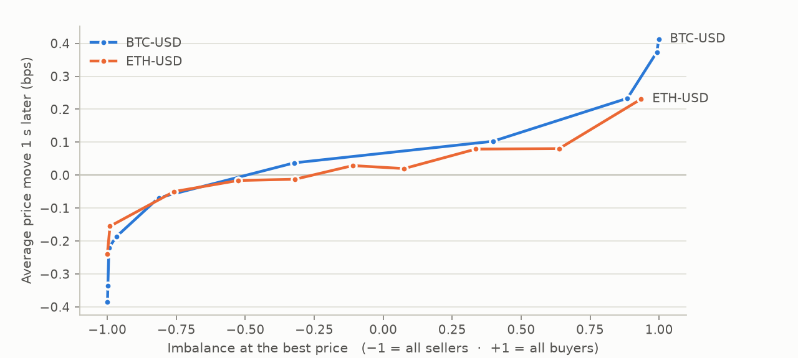
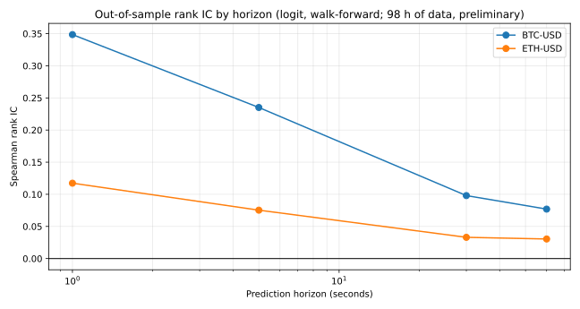
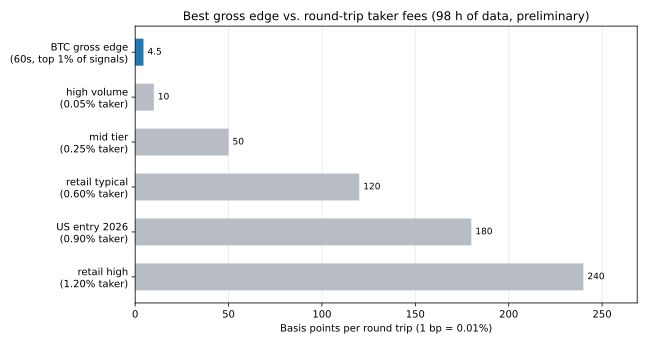
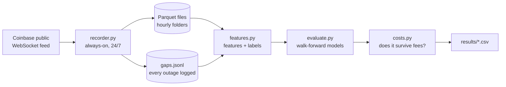

# orderbook-lab

**Can the live Coinbase order book predict where Bitcoin's price moves in the next few seconds, and is that prediction worth anything once you pay to trade?**

This repo is my end-to-end answer. It covers an always-on recorder for Coinbase's live market data, a feature and labeling pipeline that won't let the future leak into the past, time-ordered model evaluation, and a cost model that checks whether any edge survives the spread and exchange fees.

Research only. Nothing here places orders or needs an account. It only listens to Coinbase's free public feed.

*Built by [Jimmy Sim](https://github.com/Jimmy-Sim), UC Berkeley (Applied Math & CS).*

---

## The short answer (so far)

**Yes, the order book predicts the next second or two. No, the edge isn't worth trading at any fee a normal account pays.**

> Preliminary: based on about 98 hours of data per product (BTC-USD and ETH-USD, Nov 24–28 2026). The recorder is still running, and these numbers will be updated as more data accumulate.

How well the models predict, measured only on data they never trained on:

| | 1 s ahead | 5 s ahead | 30 s ahead | 60 s ahead |
|---|---|---|---|---|
| **BTC-USD** rank correlation | **0.35** | 0.24 | 0.10 | 0.08 |
| BTC-USD right direction* | 71% | 62% | 54% | 53% |
| **ETH-USD** rank correlation | 0.12 | 0.08 | 0.03 | 0.03 |

\*Counting only the times the price actually moved. 50% is a coin flip.





- **Fast decay:** the BTC signal falls from 0.35 rank correlation at 1 second to 0.08 at 60 seconds.
- **One feature does most of the work:** a one-feature model using imbalance at the best price reaches 0.33 out-of-sample rank correlation at 1 second, against 0.35 for the all-feature model. Gradient-boosted trees offer little improvement at that horizon.
- **The fees swamp the edge:** among the cost grid's settings with at least 30 trades, the best BTC gross edge is about 4.5 basis points (0.045%) per trade before costs. A round trip at a typical retail taker fee costs about 120 bps. Even the top-volume fee tier (10 bps round trip) loses money. Positive maker cases are optimistic because they assume every passive order fills.



The takeaway: these predictive signals do not cover taker fees, even at the highest-volume tier modeled here. Turning them into a viable strategy would require much lower costs or a realistic way to capture maker fills.

---

## How it works



| File | What it does |
|---|---|
| [`recorder.py`](recorder.py) | Keeps a live copy of the BTC and ETH order books. Saves the top 10 price levels every 100 ms and every trade. Reconnects automatically and logs every gap. |
| [`recorder.sh`](recorder.sh) | Start, stop and status commands. `install` registers it with macOS so it runs 24/7 and restarts after a crash. |
| [`features.py`](features.py) | Turns raw snapshots into predictors (spread, order book imbalance, microprice, trade flow, recent returns, volatility) and into labels (future price moves at 1/5/30/60 s). |
| [`evaluate.py`](evaluate.py) | Trains four models (from a one-feature baseline to gradient-boosted trees) and scores them on future data only. |
| [`costs.py`](costs.py) | Simulates a simple one-position-at-a-time strategy on the predictions and computes profit after spread and fees across six fee tiers. |
| [`run_all.py`](run_all.py) | One command runs the whole pipeline, from raw data to results; runtime grows with the recording. |
| [`plots.py`](plots.py) | Redraws the figures in this README from the latest results as clean SVGs. |
| [`automation.sh`](automation.sh) | On macOS, installs a daily launchd job that runs the evaluation and redraws the figures. |
| [`tests/`](tests) | Checks the subtle parts on hand-built data (see below). |

---

## Design decisions that are easy to get wrong

Most "price prediction" projects look great because of a mistake somewhere. These are the ones this project guards against, each with a test:

1. **No looking into the future.** Every feature uses only data available at that moment. *(`test_forward_return_and_no_lookahead_in_features`)*
2. **No reaching across outages.** If the connection drops for 20 minutes, a "60-second return" spanning the outage is meaningless. The data is split into segments at every gap or resync, and no window or label crosses a segment edge. *(`test_labels_and_windows_do_not_cross_gaps`, `test_resync_breaks_segment_even_without_time_gap`)*
3. **Test on the future, never on shuffled data.** Models train on earlier data and are tested on later data, with a 120-second embargo so labels that look ahead into the test period can't leak into training. *(`test_walk_forward_is_time_ordered_with_embargo`)*
4. **Count who actually traded.** Coinbase reports the *maker's* side of each trade. The recorder flips it to the *taker's* side, the one who crossed the spread, which is what trade-flow signals need. *(`test_trade_binning_and_flow_sign`)*
5. **No peeking when choosing which signals to trade.** The confidence cut-off is set from earlier test periods only, and the first period is never traded. *(`test_threshold_uses_only_earlier_folds`)*

---

## Run it yourself

Requires macOS or Linux, Python 3.12+ and [uv](https://docs.astral.sh/uv/).

```bash
git clone https://github.com/jimmy-sim/orderbook-lab && cd orderbook-lab
uv sync

uv run python recorder.py --products BTC-USD --minutes 2 --flush 30   # 2-minute test recording
uv run pytest -q                                                      # 10 tests

./recorder.sh start      # record in the background
./recorder.sh status     # running? disk used? gaps?
uv run python run_all.py # rebuild every result into results/
uv run python plots.py   # redraw the charts in docs/
```

For 24/7 recording on an always-on machine such as a Mac Mini, run `./recorder.sh install`. It starts at login and restarts after a crash. Keep the repo outside Desktop and Documents, because macOS blocks background access there. In System Settings, also turn on *Prevent automatic sleeping when the display is off* and *Start up automatically after a power failure*.

To refresh results and charts automatically on that Mac, run `./automation.sh install` once. It starts an evaluation immediately and then runs daily at 4:00 AM local time. The recorder keeps running during evaluation; it writes complete Parquet files atomically. Check `./automation.sh status` for the last run and `logs/automation.log` for details. Run `./automation.sh uninstall` to remove only the daily job. Charts in `docs/` change after each run; review them before committing. The written interpretation in this README still needs human review when the findings change.

Data goes to `data/` and results to `results/`. Neither is committed. The recorder adds about 200 MB a day for two products.

---

## Limitations and what's next

- **More data.** About four days still covers only a few market conditions. Weeks of data will show whether the signal is stable across days, weekends and volatile periods.
- **A realistic maker simulation.** The cost model's maker case assumes passive orders always fill. The real question for a market maker is where an order sits in the queue and whether it fills just before the price moves against it. Modeling that is the natural next step.
- **One exchange, two products.** Other venues and less liquid coins may behave differently.

---

<details>
<summary>Notes on the Coinbase feed</summary>

- `level2_batch` is the unauthenticated order book channel: the same updates as `level2`, sent in 50 ms batches.
- In Coinbase `match` messages, `side` is the **maker's** side. The recorder converts it to `taker_side`.
- Missed trades are detected from gaps in Coinbase's consecutive trade IDs. Book resyncs, reconnects and missed trades are all appended to `data/gaps.jsonl`.
- Fees: Coinbase doesn't publish a single public fee table, so `costs.py` uses a grid of scenarios. Set `REFERENCE` in `costs.py` to your own tier.

</details>
